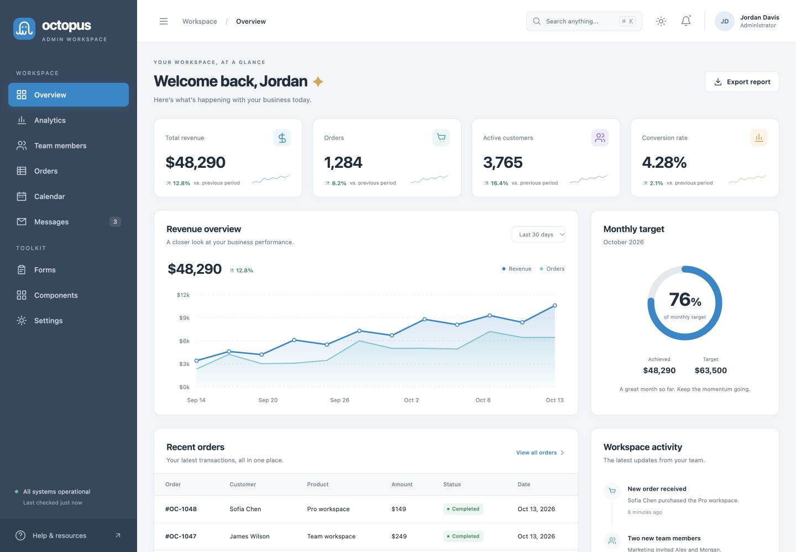

# Octopus 2.0

A modern, responsive admin dashboard by [Colorlib](https://colorlib.com), with the original Octopus slate-and-blue palette and a refreshed layout.

[Live demo](https://colorlib.com/polygon/octopus/) · [Download template](https://colorlib.com/polygon/octopus/octopus-modern.zip)



## Pages

Overview, Analytics, Team members, Orders, Calendar, Messages, Forms, Components and Settings.

## Features

- Responsive sidebar and accessible mobile navigation
- Light, dark and system appearance
- Interactive chart periods and series controls
- Searchable, filterable tables and CSV exports
- Add, deactivate and reactivate sample team members
- Calendar navigation and event creation
- Project forms, sample message replies and workspace preferences
- Keyboard page search with Cmd/Ctrl+K

The demo stores sample changes in this browser under `octopus.demo.v2.*`. It is a frontend template: connect your own authentication, API and database for production use.

## Run locally

No build step, package installation, external fonts or runtime dependencies are required. Serve the repository with any static web server. For example:

```sh
python3 -m http.server 8000
```

Open http://localhost:8000. All pages and assets are relative, so the template also works in a subdirectory.

## Customize

Edit the HTML pages, `assets/octopus.css` and `assets/octopus.js`. Theme colors and spacing use CSS custom properties. After changing a CSS or JS file, update its `?v=` hash in the HTML to refresh cached assets.

## Checks

With Node.js installed:

```sh
node --check assets/octopus.js
node scripts/check-static.mjs
```

The nine pages were checked at desktop and phone sizes, including charts, dark mode, member status, event persistence, project text escaping, saved preferences, message replies and filtered CSV download.

[Dark preview](docs/dashboard-dark.png) · [Mobile preview](docs/dashboard-mobile.png)

## Credits and license

The design preserves the original primary blue `#0088cc` and slate sidebar `#34495e`. [Original design reference](https://github.com/themezoz/octopus-dashboard). The refreshed implementation is new code by Colorlib, licensed under [MIT](LICENSE).

Historical compatibility libraries served at the demo URL are separate from this repository.
